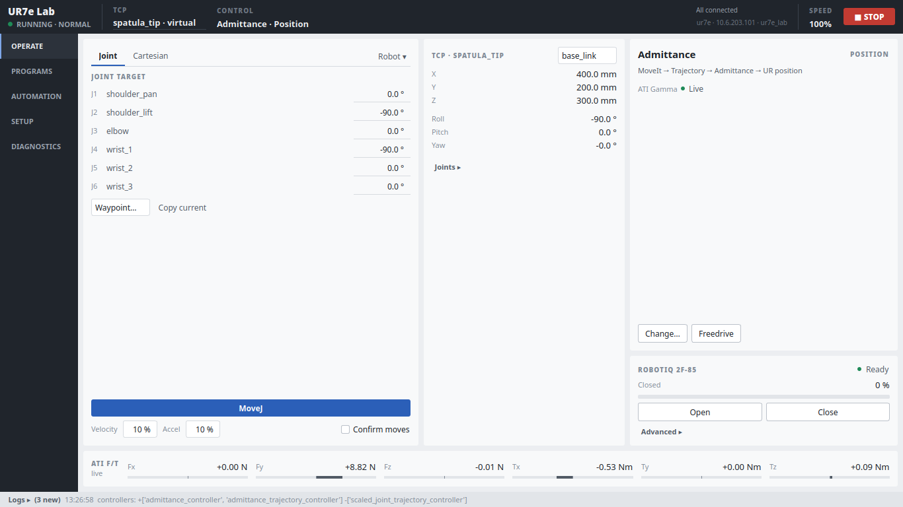

# MoveIt GUI v2

A Qt operator panel for **MoveIt 2 + Universal Robots on ROS 2 Jazzy**, built for a
UR7e with a Robotiq 2F-85 and an ATI Gamma F/T sensor. It also works for any UR model,
or for any robot with a profile YAML.



The original 2022 prototype is kept unchanged in [`legacy/`](legacy/) for reference.

## What it does

A task-oriented workstation with five screens (left rail, Ctrl+1…5). The design and the control-stack
model are described in [docs/ux-v2.2.md](docs/ux-v2.2.md); the v2.3 visual system, MoveIt routing and bringup in
[docs/ux-v2.3.md](docs/ux-v2.3.md).
Step-by-step lab workflow (tool, payload/CoG, vial, policy, scraping program): [docs/WORKFLOW-ur7e.md](docs/WORKFLOW-ur7e.md).
Browser version over Tailscale (`ros2 run moveit_gui moveit_gui_web`): [docs/WEB.md](docs/WEB.md).

| Screen | |
|---|---|
| **OPERATE** | Robot power and PolyScope controls (extras under `More ▾`); manual Joint/Cartesian motion of the active TCP in a chosen frame; current state; **arm control** card (mode, hardware interface, command source, `Change…`, freedrive); **gripper** card (independent of the arm mode, `Advanced ▸`); read-only ATI strip |
| **PROGRAMS** | Step table + context-sensitive inspector (MovePose: frame, TCP, XYZ, RPY, *Record current pose*), Run / Pause / Stop / Step, right-click and keyboard actions |
| **AUTOMATION** | Policies as capabilities: backend, control mode, hardware interface, requirements, Prepare (runner's F/T baseline progress), Run / Stop, through the RunPolicy interface boundary |
| **SETUP** | TCPs + pivot calibration, fixture wizard, vial geometry (XY circle, base-aligned), F/T + payload (saved to its own file, never to controller YAML), robot profile |
| **DIAGNOSTICS** | Arm controller chain and claimed interfaces, the gripper's own controller manager, state freshness, full log |

The header always shows the robot, the robot and safety state, speed, the active TCP and the
**arm mode · hardware interface** (e.g. `Admittance · POSITION`). The log is a collapsed drawer.


### Stops

* **STOP GUI MOTION** (header, `Esc`) stops the GUI program, cancels the MoveIt trajectory and stops a
  running policy. It does **not** stop the PolyScope program.
* **PROGRAMS ■ Stop** ends the GUI program. **AUTOMATION ■ Stop policy** stops the policy.
* **OPERATE PolyScope ■** stops the *pendant* program through the Dashboard. External Control stops too,
  so press ▶ (or Resend) before the robot can move again.

None of these is an emergency stop; that is the physical e-stop.

### Robot, control mode, command source, TCP, frame

These are independent:

* **Robot**: the profile. Changing it is a deliberate reconnect from SETUP → Robot profile, not a live
  switch.
* **Control mode**: how commands reach the joints. Position and Admittance both use the **POSITION**
  interface and take MoveIt trajectories. Impedance uses **EFFORT** (direct torque), takes a Cartesian
  reference, and is on the other side of the direct-torque boundary.
* **Command source**: manual MoveIt, a program, a policy, freedrive.
* **TCP**: which point a Cartesian pose refers to.
* **Reference frame**: what a Cartesian pose is relative to.

A policy states the mode it needs. The GUI **never switches modes on its own**: a program needs an
explicit Mode step.

## TCPs, frames and calibration

A Cartesian pose is always **T_frame_tcp** (pose of the TCP in the reference frame). Programs store
`frame`, `tcp`, `position` (m) and `quat_xyzw`, so a recorded pose still says exactly what it means months
later. Conversions all live in `geometry.py`:

* **Model-link TCPs** (`tool0`, `robotiq_tcp`) are links in the robot description; they come from the profile
  and are read-only.
* **Virtual TCPs** (`spatula_tip`, `probe_tip`, …) are a calibrated `T_parent_tcp` stored in the user
  calibration file. Before sending a goal to MoveIt the GUI converts it to the planning link:
  `T_base_tool0 = T_base_tcp · inv(T_tool0_tcp)`. No URDF change, no MoveIt restart.
  **A virtual TCP does not change MoveIt collision geometry**; a physically different tool still needs a
  robot-description update.
* **Pivot calibration** solves `R_i·p_tcp + t_i = p_pivot` by least squares, reports RMS/max residual and an
  orientation-diversity check (insufficient / poor / acceptable / good). It calibrates **position only**;
  orientation is inherited from the parent or entered by hand.
* **Fixtures** are static frames (`vial_rack`, `balance`, …), entered by hand or taught with three TCP points
  (origin, +X, +Y side; collinear or too-close points are rejected). Fixtures can be nested.
* **Vision baselines** (code and tests kept, not in the normal SETUP navigation until a Perception section exists) correct systematic bias of a pose source (TF frame or `PoseStamped` topic) from a
  robot-measured ground truth (probe TCP on the object reference) and averaged detections (proper rotation
  averaging). Two correction sides, because they behave differently once the object moves:
  `reference` (default): `T_corr = T_expected · inv(T_detected)`, `T_corrected = T_corr · T_detected`.
  This is for errors in the camera/reference frame, such as extrinsics.
  `object`: `T_corr = inv(T_detected) · T_expected`, `T_corrected = T_detected · T_corr`. This is for an
  offset in the detector's object model.
  A program can use the object name as a frame. A missing or stale detection fails the step; there is never
  a fallback to base coordinates.

Calibration is stored per profile in `$XDG_CONFIG_HOME/moveit_gui/calibrations/<profile>.yaml`
(`~/.config/...` by default), never in the package profiles. Every entry carries its method, sample count,
residuals, timestamps and robot name. A file for another robot is refused on import. Import uses
`yaml.safe_load`, validates everything (unit quaternions, parent chains, name clashes) and changes nothing
if any check fails.

The calibration hierarchy stays separate: UR factory kinematic calibration (not handled here) → TCPs →
fixtures → vision baselines.

## Install

**Web GUI on a new PC (UR7e lab setup, Docker):** see [docs/SETUP_WEB.md](docs/SETUP_WEB.md). The steps below
are the plain ROS install (desktop GUI, your own workspace).

```bash
cd ~/ws/src
git clone -b v2-ur-jazzy https://github.com/mrceki/MoveIt-GUI.git moveit_gui
git clone https://github.com/AndrejOrsula/pymoveit2.git          # upstream, Jazzy-compatible
sudo apt install python3-pyqt5 ros-jazzy-ur-msgs ros-jazzy-ur-dashboard-msgs \
                 ros-jazzy-controller-manager-msgs ros-jazzy-control-msgs
cd ~/ws && colcon build --packages-select pymoveit2 moveit_gui && source install/setup.bash
```

## Run

```bash
# 1. the driver + MoveIt stack you already use (the GUI attaches; it never launches ROS itself)
# 2. the GUI
ros2 run moveit_gui moveit_gui --profile ur7e_lab
ros2 run moveit_gui moveit_gui --fake                 # no ROS: simulated robot, try the UI
ros2 run moveit_gui moveit_gui --program ~/moveit_gui_programs/example_pick.yaml
```

On first start, the example programs and policy template are copied to `~/moveit_gui_programs`
and `~/moveit_gui_policies`. Calibration lives in `~/.config/moveit_gui/calibrations/`.

**Try it on mock hardware or URSim first**
(`ur_robot_driver ... use_mock_hardware:=true`, or `ur_type:=ur7e robot_ip:=<ursim ip>`).

## Profiles

All ROS names live in `profiles/<name>.yaml`. In `ur7e_lab.yaml`, every hardware-facing value is tagged:
`[prompt]` (stated by you, not yet compared with `~/ur7e_robotiq`), `[driver]` (standard ur_robot_driver
name) or `[guess]`. Check them with:

```bash
ros2 control list_controllers
ros2 action list -t | grep -i -e gripper -e trajectory
ros2 topic list -t  | grep -i -e wrench -e joint_states
ros2 service list | grep -e dashboard_client -e io_and_status -e robotiq
```

`moveit.planning_link` is the link MoveIt plans for (the group tip). It is **not** the TCP. Older profiles
that used `end_effector` still load.

## Mode switching and the current UR bringup

Every switch **fails closed**. It is refused, with a readable reason
(for example `Cannot enter Impedance: joint state is stale (2.0 s old)`), when any of these holds:

* the joint state is missing or older than `state.joint_state_timeout_s`
* joint velocities are unavailable, so the GUI cannot verify the arm is stationary
* a controller of the target mode is not loaded
* a policy is running, or a program is running and the switch is not its own `controller` step
* the mode `requires_ft` and the ATI topic is silent
* for experimental modes: robot mode is not RUNNING, safety mode is not NORMAL, or External Control is not
  running
* the mode has `allow_activation: false`

If preflight passes, the GUI cancels GUI motion, stops freedrive, waits for a **verified** standstill (unknown
counts as not still), sends one STRICT `switch_controller` request, and finally checks that exactly the
target mode's controllers are active.

**Impedance (direct torque) is enabled** in `ur7e_lab` (`allow_activation: true`; set it false to lock the mode
out). It keeps the strict preflight above and the reference-pose check, and rolls back on failure. After any switch, the claimed interfaces are checked: every arm joint must be claimed with
exactly the mode's `command_interface`. For direct-torque targets, unreadable claims count as a failure.

**Blocker: one controller manager with all modes loaded.** The current `ur7e_robotiq` stack has three
separate commissioning launches, so live switching needs a GUI-oriented launch that loads every mode's
controllers with only the position path active (keep the three existing launches). I have not been able to
read that repository, so it is not written yet. Questions to answer from the real source first:
whether the driver's command-interface claiming lets the admittance chain and the torque controller be
*loaded* side by side; whether the Robotiq controllers run on a separate controller manager; and how MoveIt
picks between `scaled_joint_trajectory_controller` and `admittance_trajectory_controller`. If
`moveit_ros_control_interface/Ros2ControlManager` is used, set `moveit_manage_controllers: false` so
MoveIt never switches controllers itself. Until that launch exists, switching to a mode whose controllers
aren't loaded is refused with "controller(s) not loaded".

## Programs

```yaml
version: 2
name: scrape_vial
robot: ur7e_lab
waypoints:
  above_vial:
    pose: {frame: vial_rack, tcp: spatula_tip, position: [0.02, 0.03, 0.04], quat_xyzw: [1, 0, 0, 0]}
steps:
  - {type: controller, mode: position}
  - {type: movej, target: ready, velocity: 0.2}          # profile or program joint waypoint
  - {type: move_pose, target: above_vial, velocity: 0.1}
  - {type: controller, mode: admittance}
  - {type: policy, policy: scrape_policy_v4, duration: 8.0}
  - {type: controller, mode: position}
  - {type: movej, target: home}
```

Step types: `movej`, `move_pose` (`cartesian: true` = linear), `gripper`, `wait`, `controller`, `policy`,
`set_io`, `speed`.

**Preflight** runs before the first step and before "Run selected step". It checks every step without
moving anything: TCPs and frames exist and resolve now, quaternions are unit, modes exist and are enabled,
policies exist with their files present, and the gripper is up. **Check program** runs the same preflight
on demand.

**v1 files still load.** v1 poses had no frame or TCP and were executed as the MoveIt end-effector link in
the base frame, so they are migrated as `frame: base_link, tcp: <planning link>`. Using the active TCP
instead would move the robot somewhere else. The Program tab shows what was interpreted. The file is only
rewritten (as v2) when you save it.

## Policies

A policy is a command source with a manifest in `~/moveit_gui_policies/<name>.yaml`; see
`policies/_template.yaml.example`. The manifest gives `required_mode`, `backend`, `control_hz`,
`requires_ft`, and the model / normalization / training-config files.

The GUI does not load models. It checks the manifest (files exist, required mode already active, F/T live)
and then starts your runner. It stops the runner with SIGINT at the end of `duration` or on Stop.
Observation and action dimensions are not checked here; the runner must check them. The plan is still to
replace the subprocess with a `RunPolicy` ROS action.

## Architecture

```
moveit_gui/
  app.py            entry point, profile switching
  profile.py        RobotProfile (YAML) + reorder_joints()                    -- no ROS
  transforms.py     4x4 transforms, quaternions, rotation averaging          -- no ROS
  calibration.py    calibration store (XDG), pivot, 3-point frame, baselines -- no ROS
  geometry.py       frames + TCPs: T_frame_tcp <-> MoveIt link goals         -- no ROS
  control_modes.py  fail-closed preflight + STRICT switch + verification    -- no ROS
  program.py        programs v2 (+ v1 migration), preflight, ProgramRunner   -- no ROS
  policies.py       policy manifests, subprocess runner                      -- no ROS
  bridge_api.py     Snapshot + what a bridge must provide
  ros_bridge.py     the single rclpy node (executor in a background thread)
  fake_bridge.py    simulated robot + TF tree + detector for tests and --fake
  policy_action.py  RunPolicy goal/feedback/result + mock and subprocess runners (no inference here)
  gui/              Qt shell + OPERATE/PROGRAMS/AUTOMATION/SETUP/DIAGNOSTICS pages; polls snapshot() at
                    10 Hz, blocking calls in worker threads
```

Transform convention everywhere: `T_a_b` is the pose of frame `b` in frame `a`, so `p_a = T_a_b · p_b`.
Quaternions are always `xyzw`.

There is one long-lived ROS node. ROS callbacks only update a locked state object and never touch widgets.
Service calls and motion run in worker threads.

```bash
python3 -m pytest test        # 71 tests, no ROS required
moveit_gui --fake             # the whole UI on a simulated robot (all fake numbers)
```

## Roadmap

1. GUI-oriented UR bringup with all mode controllers loaded (see the blocker above); validate Position ↔
   Admittance on the robot, then impedance
2. Read-only admittance parameters (axes, mass, damping, stiffness) from the controller; presets later
3. `RunPolicy` action instead of subprocesses
4. Orientation calibration for TCPs (axis / three-point)
